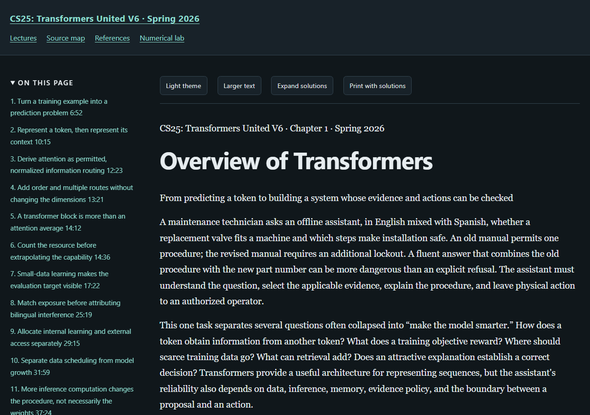

# Stanford CS25: Transformers United V6, Spring 2026

An independently written study book following nine Stanford recordings. The course recordings determine the topic order; the explanations, derivations, finite programs and worked exercises are educational additions.

[Read the online textbook](https://az9713.github.io/cs25-transformers-united-notes/) · [Source and timestamp map](https://az9713.github.io/cs25-transformers-united-notes/source-map.html) · [Primary references](https://az9713.github.io/cs25-transformers-united-notes/references.html) · [Numerical laboratory](https://az9713.github.io/cs25-transformers-united-notes/numerical-lab.html)

[Official course page](https://web.stanford.edu/class/cs25/index.html) · [Recording playlist](https://www.youtube.com/playlist?list=PLoROMvodv4rPZxxeUFvQHCkZJsaEBdDZj)

Nine chapters contain 54 complete worked solutions and nine executable chapter examples, with a cumulative laboratory. Attention, representation learning, state space models, distributed training, learning objectives, generalization, scientific agents, multimodal models and production inference.



## Read the chapters online

| Book chapter | Live chapter | Stanford recording |
|---:|---|---|
| 1 | [Overview of Transformers](https://az9713.github.io/cs25-transformers-united-notes/lecture-01-overview-of-transformers.html) | [Recording 1](https://www.youtube.com/watch?v=bHSDPgZYie0) |
| 2 | [From Representation Learning to World Modeling](https://az9713.github.io/cs25-transformers-united-notes/lecture-02-representation-learning-and-world-modeling.html) | [Recording 2](https://www.youtube.com/watch?v=GBd7iuJkW08) |
| 3 | [On the Tradeoffs of State-Space Models and Transformers](https://az9713.github.io/cs25-transformers-united-notes/lecture-03-state-space-models-and-transformers.html) | [Recording 3](https://www.youtube.com/watch?v=OyimE74UMF8) |
| 4 | [Training at GPU Scale](https://az9713.github.io/cs25-transformers-united-notes/lecture-04-training-at-gpu-scale.html) | [Recording 4](https://www.youtube.com/watch?v=I5BKi32IEa8) |
| 5 | [From Next-Token Prediction to Next-Generation Intelligence](https://az9713.github.io/cs25-transformers-united-notes/lecture-05-from-next-token-prediction-to-next-generation-intelligence.html) | [Recording 5](https://www.youtube.com/watch?v=e_H_tkpCAK4) |
| 6 | [Distinct Modes of Generalization from Parameters and Context](https://az9713.github.io/cs25-transformers-united-notes/lecture-06-distinct-modes-of-generalization-from-parameters-and-context.html) | [Recording 6](https://www.youtube.com/watch?v=dJtHauhRasc) |
| 7 | [AI Agents for Science and Medicine](https://az9713.github.io/cs25-transformers-united-notes/lecture-07-ai-agents-for-science-and-medicine.html) | [Recording 7](https://www.youtube.com/watch?v=jFdH7n6BAl0) |
| 8 | [From Language Models to Native Multimodal Intelligence](https://az9713.github.io/cs25-transformers-united-notes/lecture-08-native-multimodal-intelligence.html) | [Recording 8](https://www.youtube.com/watch?v=NDdc39KYqDU) |
| 9 | [Serving Transformers: Lessons from Production Inference](https://az9713.github.io/cs25-transformers-united-notes/lecture-09-serving-transformers-lessons-from-production-inference.html) | [Recording 9](https://www.youtube.com/watch?v=ZUdIsRZhWXI) |

## What the book adds

Each chapter develops assumptions, notation, derivations, interpretations, limitations and exercises around its recording. Timestamp links locate the related discussion. The source map distinguishes lecture material, primary research and original teaching constructions; research claims retain their source versions and experimental conditions.

## Validation and remaining limits

All nine chapters and the book-wide manuscript passed independent editorial review within the recorded scopes. Local validation covers source identity, executable examples and displayed output, reader controls, links, mathematical rendering, desktop/mobile layouts and public-file privacy. The actual validation records state their scope and artifact hashes:

- [Validation summary](validation-summary.json)
- [Reader checks](reader-validation.json)
- [Editorial scope and chapter guards](editorial-summary.json)

Six official slide decks contain 496 pages. Talks 3 and 7 have no official deck; Talk 5 repeats Talk 4's deck link and that duplicate is excluded from Talk 5 evidence. The human keyboard and screen-reader audit is not performed. Full accessibility certification remains pending. Publication is authorized separately and does not imply those outstanding checks were performed.

Transcript hashes and timing checks establish file identity and valid intervals; they do not establish human-verified speech recognition. The finite programs do not reproduce large model or GPU benchmarks. Speaker opinions, company reports, empirical observations and formal results retain distinct evidence grades.

## Attribution and source boundaries

This is an independent educational contribution. Stanford supplies the course recordings and their intellectual context; cited research is attributed to its original creators. This repository is not an official Stanford publication or endorsement. It links to recordings and papers. Raw media, machine transcripts, acquired paper/deck copies, private acquisition logs and editorial working files are excluded.

## Use locally

Download this repository and open `index.html`, or serve the directory with `python -m http.server 8000 --bind 127.0.0.1`. The bundled reader and mathematics work offline; external recording and research links require internet access.

All nine standalone chapter programs and the cumulative laboratory use Python's standard library. Individual programs are `chapter01.py` through `chapter09.py`.

```sh
python numerical_lab.py
```

GitHub Pages serves the `main` branch root. `.nojekyll` keeps this a static HTML package. The bundled MathJax license is in `assets/mathjax-LICENSE`.
